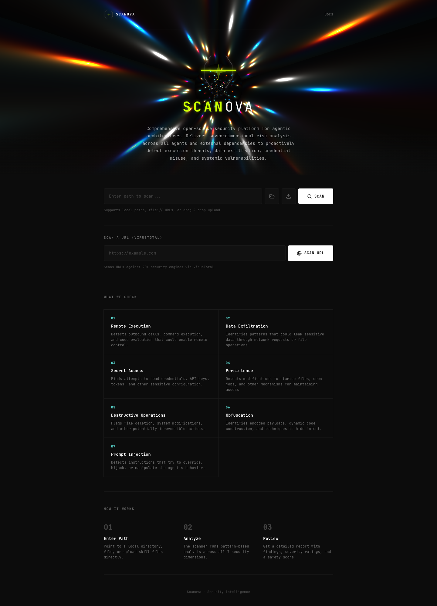

# Scanova

Security intelligence platform for AI agent skill files. Detects risky patterns across 7 dimensions with forensic-grade reporting.




## Overview

Scanova is a security analysis tool that scans agent skill definitions for potential risks and policy violations. It combines local static analysis across 7 security dimensions with VirusTotal URL scanning (70+ engines) and AI-powered remediation summaries via Ollama.

## Features

- **7-Dimension Security Analysis** — Remote Execution, Exfiltration, Secret Access, Persistence, Destructive Ops, Obfuscation, and **Prompt Injection**
- **Remote File Scanning** — Fetch and scan any `http`/`https` URL directly from the CLI before installing a skill
- **Three Output Formats** — Terminal (rich, color-coded), JSON (CI/CD), and **Markdown** (shareable audit reports)
- **Single-File Scanning** — Scan a single `.md`, `.py`, or other file, not just directories
- **Score Compounding** — Risk score amplifies when multiple findings land in the same dimension, reflecting coordinated threat patterns
- **Docker / Air-Gap Mode** — Run the scanner in an isolated container with zero network access so suspicious skills cannot phone home during analysis
- **VirusTotal URL Scanning** — Check URLs against 70+ antivirus engines (dashboard)
- **AI-Powered Summaries** — Plain-language explanations and remediation steps via local Ollama LLM (dashboard)
- **Interactive Dashboard** — React + Vite frontend with Simple/Detailed views, severity bento cards, donut/radar charts, and forensic finding cards

## Quick Start

### Prerequisites

- Python 3.11+
- Node.js 18+ (dashboard only)
- (Optional) [Ollama](https://ollama.ai) with `llama3` model for AI summaries
- (Optional) VirusTotal API key for dashboard URL scanning

### Install the CLI

```bash
pip install -e .
```

### Run the Dashboard

```bash
./run-dashboard.sh
```

Opens the FastAPI backend on `http://localhost:8000` and the Vite frontend on `http://localhost:5173`.

## CLI Usage

### Scan a local directory

```bash
skill-scanner /path/to/skill
```

### Scan a single file

```bash
skill-scanner /path/to/skill/SKILL.md
```

### Scan a remote file before installing

```bash
skill-scanner --url https://raw.githubusercontent.com/user/repo/main/SKILL.md
```

Fetches the file, runs all rules against it locally, then deletes the temp copy. Nothing is executed. The URL is shown in every finding instead of a temp path.

### Output formats

```bash
# Rich terminal output (default)
skill-scanner /path/to/skill

# Structured JSON for CI/CD tooling
skill-scanner /path/to/skill --format json

# Markdown audit report — save and share
skill-scanner /path/to/skill --format markdown > report.md
skill-scanner --url https://... --format markdown > report.md
```

### Filtering and CI/CD

```bash
# Report only MEDIUM and above
skill-scanner /path/to/skill --severity MEDIUM

# Exit code 2 if any HIGH+ finding exists (blocks CI pipeline)
skill-scanner /path/to/skill --fail-on HIGH

# Exclude files by glob
skill-scanner /path/to/skill --exclude "*.test.js" --exclude "docs/*"

# Quiet mode: score + verdict only
skill-scanner /path/to/skill --quiet
```

### Exit codes

| Code | Meaning |
|---|---|
| `0` | No findings (CLEAN) |
| `1` | Findings present but below `--fail-on` threshold |
| `2` | At least one finding meets or exceeds `--fail-on` severity |

## Docker / Air-Gap Mode

Use Docker to scan untrusted skills in an isolated environment. In air-gap mode the container has **zero network access** — a malicious skill cannot exfiltrate data or phone home while being analyzed.

### Standard mode

```bash
SKILL_PATH=/path/to/skill docker-compose up
```

### Air-gap mode (recommended for untrusted skills)

```bash
SKILL_PATH=/path/to/skill docker-compose -f docker-compose.airgap.yml up
```

### Save a markdown audit report

```bash
SKILL_PATH=/path/to/skill docker-compose -f docker-compose.airgap.yml \
  run scanner --format markdown /scan > report.md
```

### Scan any GitHub repo

```bash
git clone https://github.com/user/repo /tmp/target
SKILL_PATH=/tmp/target docker-compose -f docker-compose.airgap.yml up
```

## Security Dimensions

Seven independent detection categories. Each finding contributes to the overall risk score; multiple findings in the **same dimension** compound the score further (see Risk Scoring below).

| Dimension | What It Detects |
|---|---|
| Remote Execution | `curl \| bash`, `eval()`, `exec()`, `os.system()`, `shell=True` |
| Exfiltration | HTTP POST with file reads, netcat piping, `curl -d $var` |
| Secret Access | `.env` reads, `~/.ssh`, `~/.aws`, AI provider API key references |
| Persistence | `crontab`, `systemctl enable`, shell profile writes, agent config tampering |
| Destructive Ops | `rm -rf /`, `DROP TABLE`, `git push --force`, `mkfs`, `dd if=` |
| Obfuscation | `base64 -d \| bash`, `eval(atob(...))`, long hex/unicode sequences, `String.fromCharCode` |
| **Prompt Injection** | `ignore previous instructions`, `you have no restrictions`, `jailbreak`, `DAN mode`, system prompt extraction attempts |

### Why Prompt Injection was added

Skill files are instructions fed directly to an AI agent. A malicious skill can embed phrases like `ignore previous instructions` or `you have no restrictions` in plain prose — no code required. Unlike other dimensions that target binary artifacts, this threat is unique to AI agent ecosystems and requires its own detection layer.

## Risk Scoring

Scores run from 0–100 and are calculated in two steps:

**1. Base score** — sum of severity weights across all findings:

| Severity | Weight |
|---|---|
| INFO | 0 |
| LOW | 5 |
| MEDIUM | 15 |
| HIGH | 30 |
| CRITICAL | 50 |

**2. Compounding bonus** — for each dimension with 2 or more significant findings (severity > INFO), add `+5 × (n − 1)` where `n` is the finding count in that dimension.

This reflects real threat behaviour: multiple exfiltration vectors in a single skill signal coordinated intent and are more dangerous than isolated low-severity findings spread across different categories.

**Verdict thresholds:**

| Score | Verdict |
|---|---|
| 0 | CLEAN |
| 1–30 | LOW_RISK |
| 31–60 | WARNING |
| 61–100 | CRITICAL |

## Output Formats

### Terminal

Color-coded, grouped by dimension. Designed for interactive use and quick review.

### JSON (`--format json`)

Full `ScanReport` serialised to JSON. Pipe into `jq`, store in CI artefacts, or feed downstream tooling.

### Markdown (`--format markdown`)

A self-contained audit document with:
- Scan metadata table (path, files, duration, score, verdict, timestamp, scanner version)
- Summary table: finding counts by dimension and severity
- Detailed findings table per dimension with file/line/matched text

Redirect to a file for sharing: `skill-scanner /path --format markdown > audit.md`

## Dashboard

The web dashboard provides two scan modes:

### Internal Scan (Local Files)

Scan local directories for security findings with:
- **Simple View** — Dimensions sidebar with filterable forensic finding cards
- **Detailed View** — Severity bento cards, donut charts (findings by category, severity breakdown, safety score), radar chart, and top findings table

### External Scan (VirusTotal URL)

Analyze URLs via VirusTotal with:
- **Summary Bar** — Safety score, verdict, engines scanned, flagged count
- **Simple View** — Engine categories sidebar with per-engine forensic cards
- **Detailed View** — Severity bento cards, donut/radar charts, top results table

### AI Summary

Click "Generate AI Summary" on any scan result to get a local LLM-powered analysis with risk assessment and prioritized remediation steps. Requires Ollama running locally.

## Configuration

Set these environment variables (or place in `dashboard/backend/.env`):

| Variable | Description | Default |
|---|---|---|
| `VIRUSTOTAL_API_KEY` | VirusTotal API key for dashboard URL scanning | — |
| `OLLAMA_BASE` | Ollama server URL | `http://localhost:11434` |
| `OLLAMA_MODEL` | LLM model for AI summaries | `llama3` |

## API Endpoints

| Method | Path | Description |
|---|---|---|
| POST | `/api/scan` | Scan a local directory |
| POST | `/api/scan/url` | Scan a URL via VirusTotal |
| POST | `/api/ai/summary` | Generate AI summary of results |
| POST | `/api/scan/file-url` | Scan a file:// URL |
| POST | `/api/scan/upload` | Scan uploaded files |
| POST | `/api/directory/list` | Browse local directories |
| POST | `/api/directory/find-skills` | Find skill files in a directory |
| GET | `/api/browser/locations` | Get common file paths |

## Project Structure

```
scanova/
├── src/skill_scanner/
│   ├── cli.py              # Click CLI entry point
│   ├── scanner.py          # File discovery, scan orchestration, URL fetching
│   ├── models.py           # Pydantic models (Finding, ScanReport, Severity)
│   ├── browser_scanner.py  # Browser file access support
│   ├── rules/              # Detection rules by dimension
│   │   ├── base.py         # Rule registry, base classes, markdown context detection
│   │   ├── remote_exec.py
│   │   ├── exfiltration.py
│   │   ├── secret_access.py
│   │   ├── persistence.py
│   │   ├── destructive.py
│   │   ├── obfuscation.py
│   │   └── prompt_injection.py   # ← Dimension 7
│   └── formatters/
│       ├── terminal.py     # Rich terminal output
│       ├── json_fmt.py     # JSON output
│       └── markdown_fmt.py # ← Markdown audit report
├── dashboard/
│   ├── backend/
│   │   └── server.py       # FastAPI API server
│   └── frontend/
│       └── src/
│           ├── Dashboard.jsx
│           └── index.css
├── tests/                  # pytest test suite (80%+ coverage)
├── Dockerfile              # ← Production image
├── docker-compose.yml      # ← Standard Docker mode
├── docker-compose.airgap.yml  # ← Zero-network air-gap mode
├── pyproject.toml
└── run-dashboard.sh        # One-command dashboard launcher
```

## Development

```bash
# Install dev dependencies
pip install -e ".[dev]"

# Run tests
pytest

# Run with coverage
pytest --cov=skill_scanner --cov-report=html

# Lint
ruff check src/

# Format
ruff format .

# Frontend dev
cd dashboard/frontend && npm run dev
```

> **Note:** `tests/fixtures/malicious_skill/` contains deliberately malicious sample text used to test the scanner's rules. This is normal for a security scanner, but antivirus tools or GitHub may flag it.

## License

MIT
